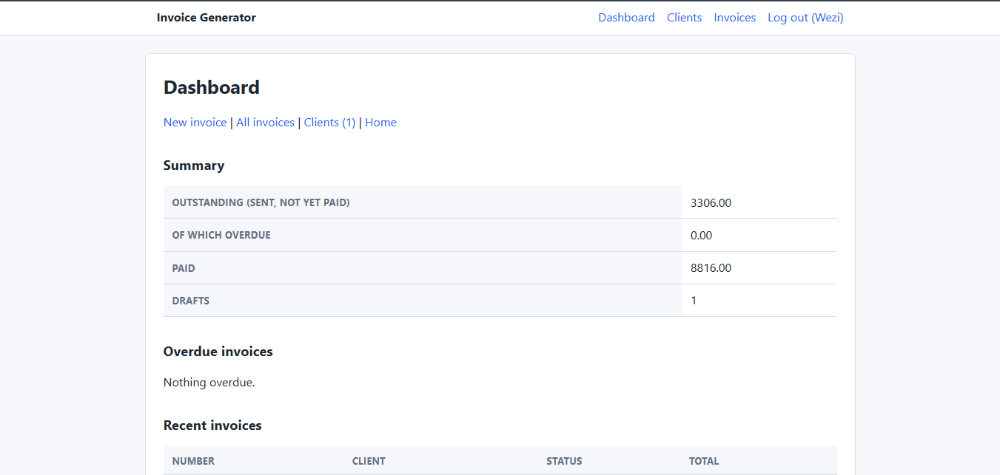
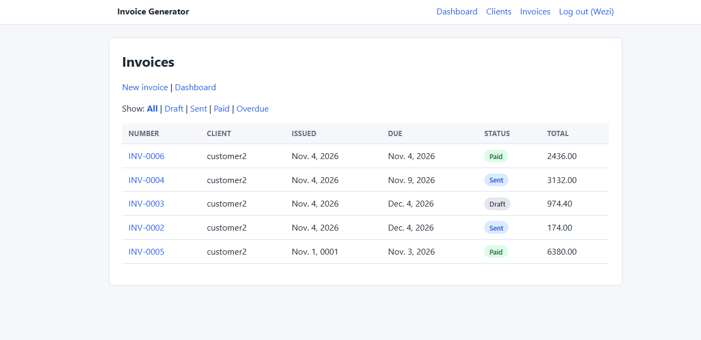
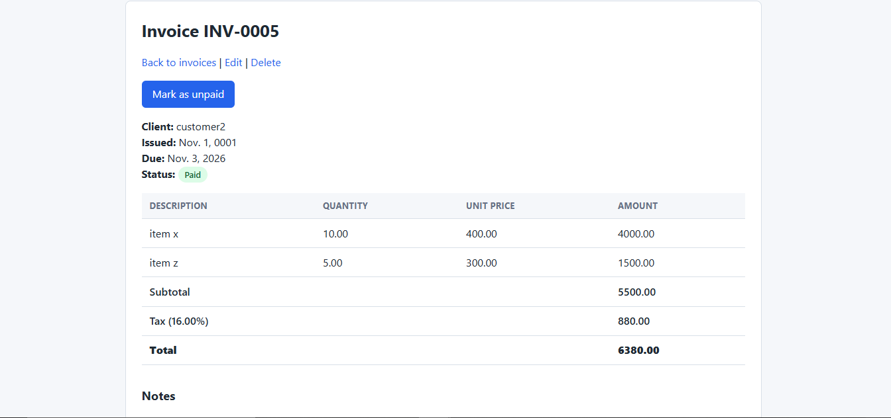

# Invoice Generator

A web app for freelancers and small businesses to manage clients and create, track and send invoices. Built with Python and Django.

**Live demo:** _coming soon_

## Screenshots

**Dashboard**



**Invoice list with status filters**



**Invoice detail**



## Features

- User accounts: register, log in and log out
- Client management: add, edit, delete and list clients
- Invoices with multiple line items, tax rate and automatic totals
- Automatic invoice numbering per user (INV-0001, INV-0002, ...)
- Invoice statuses: draft, sent and paid, with an automatic **overdue** label for sent invoices past their due date
- Dashboard with outstanding, overdue and paid totals and recent invoices
- Invoice list filtering by status
- Every user can only see and change their own data
- Responsive layout that works on phones

## Tech stack

- **Backend:** Python 3.12, Django
- **Database:** SQLite (development)
- **Frontend:** Django templates and a hand-written CSS stylesheet
- **Version control:** Git and GitHub, with a branch and pull request per feature

## Getting started

You need Python 3.12 or newer and Git installed.

```bash
# 1. Clone the repository
git clone https://github.com/WeziZimba-Z10/invoice-generator.git
cd invoice-generator

# 2. Create and activate a virtual environment
python -m venv venv
venv\Scripts\activate          # Windows
# source venv/bin/activate     # macOS / Linux

# 3. Install dependencies
pip install -r requirements.txt

# 4. Create the database tables
python manage.py migrate

# 5. Start the development server
python manage.py runserver
```

Then open http://127.0.0.1:8000 in your browser, create an account, add a client, and create your first invoice.

## Project structure

```
invoice-generator/
├── accounts/     # registration, login, logout
├── clients/      # client model and pages
├── invoices/     # invoice and line item models, dashboard, pages
├── config/       # project settings and root URLs
├── templates/    # HTML templates
├── static/css/   # stylesheet
├── docs/         # README screenshots
└── manage.py
```

## Design decisions

- **Money is stored as `Decimal`, not `float`.** Floating-point numbers can't represent values like 0.1 exactly, which causes rounding errors in totals.
- **Totals are calculated, not stored.** Subtotal, tax and total are computed from the line items, so they can never get out of sync with the data.
- **"Overdue" is derived from the due date.** It isn't a stored status. A sent invoice whose due date has passed is overdue, so the label is always correct.
- **Data is scoped to the logged-in user.** Every query filters by owner, and other users' records return a 404 page.
- **Clients with invoices can't be deleted.** The relationship is protected so financial records are never lost by accident.
- **Invoice and line items are saved in one database transaction**, so a failure can't leave a half-saved invoice.

## Roadmap

- [x] User accounts
- [x] Client management
- [x] Invoices with line items and totals
- [x] Dashboard, overdue invoices and filters
- [x] Styling and responsive layout
- [ ] PDF export and emailing invoices
- [ ] Quotes that convert into invoices
- [ ] Automated tests and continuous integration (GitHub Actions)
- [ ] Docker setup
- [ ] Deployment

## Author

Built by Wezi Zimba as a portfolio project while learning full-stack development.